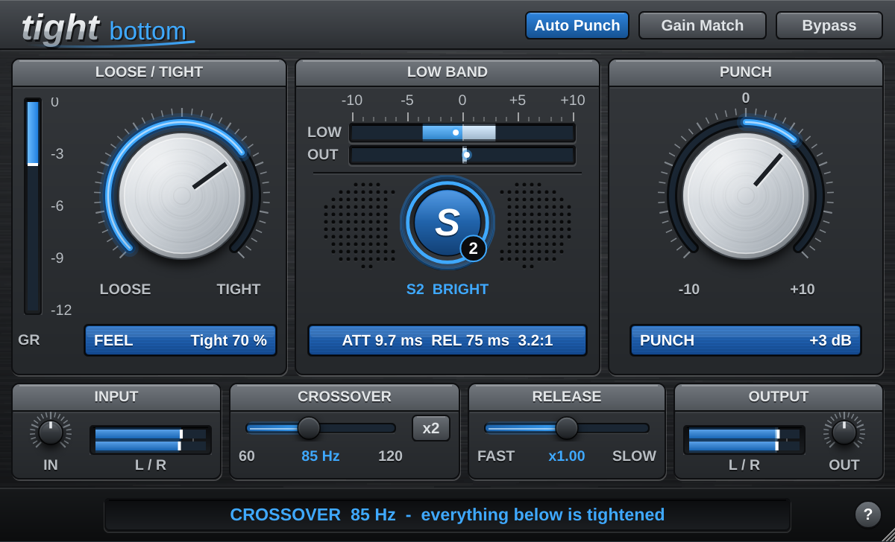

# TIGHT BOTTOM

A low-end tightener (VST3, Windows) for the mix bus, drum bus or master, built with JUCE 8.
It splits off the kick and bass with a Linkwitz-Riley crossover, glues them with a single
low-band compressor whose threshold follows the music, then lets you add punch back.
The GUI uses the same procedural look as Virus Delay. It has no bitmaps, and the name,
wordmark and artwork are original.



## Signal flow

```
Input -> IN trim -> S filter (Off / 1 Clean / 2 Shape)
      -> LR4 crossover -+- Low band  -> Compressor (Tight/Loose) -> Auto Punch -> Low End -+- Sum
                        +- High band -> untouched (phase-aligned) ------------------------+
      -> Gain Match -> OUT trim -> Output                                (zero latency)
```

## Controls

| Control | What it does |
|---------|--------------|
| **LOOSE / TIGHT** (left big knob) | Turn it up for tighter, down for looser. One macro for the low-band compressor: attack 30 to 6 ms, release 250 to 45 ms, ratio 1.5:1 to 4:1, threshold 1 to 6 dB under the band's own long-term level. Hover it to see the current values |
| **PUNCH** (right big knob) | -10 to +10 dB on the low band after the compressor, to put punch back. With Auto Punch on, it adds even more on top (this is the spec's "Low End" control) |
| **S** (sonic enhancer, round button) | Cycles Off, 1 Dull (65 Hz 24 dB/oct high-pass) and 2 Bright (high-pass, -2 dB at 160 Hz, +1.5 dB at 280 Hz). Click-free. Use your ears; it differs per track |
| **CROSSOVER** + **x2** | Everything below the crossover (the blue part of the slider) is tightened. 60 to 120 Hz, or 120 to 240 Hz with x2. Default 120 Hz. Double-click the CROSSOVER name to show the exact frequency |
| **RELEASE** | Scales the macro's release from x0.5 (FAST) to x2 (SLOW) |
| **IN / OUT** | -12 to +12 dB trims. OUT comes after Gain Match |
| **AUTO PUNCH** (top corner) | Automatic makeup on the low band (inverse of the average GR over about 400 ms). Turning Tight/Loose changes the feel, not the level. On by default |
| **GAIN MATCH** (top corner) | Output follows input loudness (K-weighted, about 3 s, max ±12 dB) for a fair A/B with Bypass. Off by default |
| **BYPASS** (top corner) | Click-free. It is also the host bypass in Cubase |

**Typical use:** turn LOOSE / TIGHT up and watch the dot on the **LOW** meter move left (the low end
is being held down). Then either turn PUNCH up until the dot bounces around 0, or press Auto
Punch to do that automatically and use PUNCH to add more weight on top. Gain Match lets you hear
only the tightening, not a level change.

**Meters:** **GR** (left) shows low-band gain reduction from 0 to -12 dB. The centre meter's
**LOW** row shows reduction (blue, left of 0) and Auto Punch + Low End (pale, right of 0); the
dot is the net change. **OUT** shows how far the output level differs from the input. **IN /
OUT** are L/R peak meters.

**Knobs and sliders** move in steps of 1 when you drag them or use the scroll wheel (Shift gives
0.1 steps), and double-click resets them. Hover any control for its value, or double-click a section name to show its setting in the bottom display. The window resizes
from 75 to 200 % from the bottom-right corner and remembers its size. All parameters can be
automated and are saved with the project.

## Building on Windows (Visual Studio 2022)

Requirements: CMake 3.22 or newer and Visual Studio 2022 with "Desktop development with C++".
JUCE 8.0.4 is downloaded automatically.

```bash
cmake -B build -G "Visual Studio 17 2022"
```

```bash
cmake --build build --config Release
```

The plugin is built to:

```
build\TightBottom_artefacts\Release\VST3\TIGHT BOTTOM.vst3
```

Install it by copying the whole `.vst3` folder into the system VST3 folder. Run this from an
**administrator** Command Prompt, in the project folder:

```bash
xcopy /E /I /Y "build\TightBottom_artefacts\Release\VST3\TIGHT BOTTOM.vst3" "C:\Program Files\Common Files\VST3\TIGHT BOTTOM.vst3"
```

Then rescan plug-ins in Cubase (Studio > VST Plug-in Manager > Rescan). The plugin is under
**Dynamics**.

To run the unit tests:

```bash
ctest --test-dir build -C Release --output-on-failure
```

Options (add `-DNAME=ON` to the first command):

| Option | Default | Meaning |
|--------|---------|---------|
| `TIGHTBOTTOM_BUILD_STANDALONE` | OFF | Also build a standalone app for quick testing |
| `TIGHTBOTTOM_BUILD_TESTS`      | ON  | Build the DSP unit tests |
| `TIGHTBOTTOM_COPY_AFTER_BUILD` | OFF | Copy the plugin to the plug-in folder after building (needs admin rights) |
| `JUCE_DIR`                     | ""  | Use a local JUCE checkout instead of downloading one |

## Getting a build without Visual Studio

Every push to `main` runs GitHub Actions (`.github/workflows/build.yml`) on `windows-latest`.
It builds the VST3, runs the unit tests and pluginval at strictness level 5, then publishes
`TIGHT-BOTTOM-VST3-Windows-x64.zip` to the **`builds`** branch of this repository. Download it
from GitHub: switch to the `builds` branch, click the zip, then click "Download raw file". Unzip
it and copy `TIGHT BOTTOM.vst3` as shown above.

## Voicing

Every number that defines the sound lives in **`Source/Voicing.h`**, with a comment on each.
These are the main ones for changing the character:

| Constant | Effect |
|----------|--------|
| `tightAttackMs` / `looseAttackMs` | Attack. Longer lets more of the kick transient through before the clamp |
| `tightReleaseMs` / `looseReleaseMs` | Release. Shorter gives more pump and bounce; longer gives a smoother, glued bass |
| `tightThreshOffsetDb` / `looseThreshOffsetDb` | How far under the long-term level the threshold sits. This is effectively how much it compresses |
| `tightRatio` / `looseRatio` | How hard it holds peaks once over the threshold |
| `kneeDb` | Softer knee for gentler onset, harder knee for a more obvious grab |
| `crossoverDefaultHz` | How much of the low end goes into the compressor (kick only, or kick + bass body) |
| `detectorRmsMs` | Shorter follows each kick more closely; longer reacts to bass sustain |
| `autoPunchAverageMs`, `autoPunchAmount` | How fast and how fully the makeup restores the level |
| `sBell1*` / `sBell2*`, `sHighPass*` | The S2 "Shape" curve and the S1/S2 high-pass |

Changing ranges (crossover slider, Low End, IN/OUT, release scale) also changes what existing
automation maps to, so tweak those before you rely on the plugin in projects.

## Project layout

```
CMakeLists.txt
Source/
  Voicing.h                    all sound-defining constants
  Parameters.h                 parameter IDs, ranges, value text
  PluginProcessor.h/.cpp       APVTS, bypass, state save/restore
  PluginEditor.h/.cpp          layout, background, meters, resizable wrapper
  CustomLookAndFeel.h/.cpp     procedural knobs, sliders, panels, LCDs (Virus Delay look)
  UI/Components.h/.cpp         knob/slider interaction, S button, meters, help
  DSP/Filters.h                biquad, TPT SVF, LR4 crossover, K-weighting
  DSP/LowBandCompressor.h      RMS detector, auto threshold, soft knee, Tight/Loose, Auto Punch
  DSP/TightBottomEngine.h      the whole signal flow (plain C++, no JUCE)
Tests/Tests.cpp                crossover flatness, compressor static curve, Gain Match, safety
```
